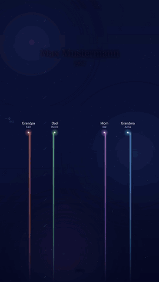

# Lebenslinien (Life Lines)

[Deutsch](README.md) · **English**

[](https://github.com/EdgarM73/LebensLinien/actions/workflows/test.yml)
[](https://github.com/EdgarM73/LebensLinien/releases)
[](https://github.com/EdgarM73/LebensLinien/pkgs/container/lebenslinien)
[](LICENSE)

Turns one person from **Gramps Web** into a portrait video (1080×1920): every close family member is a glowing thread.
New people swing into your life (births, marriages), people who have died rise as stars, and in the end everything
joins into a constellation.

<p align="center"></p>
<p align="center"><sub>Example with invented data (sped up)</sub></p>

Idea: [@SecretFire79](https://x.com/SecretFire79)

## Features

- **Family from Gramps Web:** grandparents, parents, siblings, partners, children, grandchildren and their spouses, read through the REST API (read access is enough).
- **Friends, colleagues and other companions** can be added by hand.
- **Living picture:** newborns appear in their place, couples and families stand together, a divorce makes the line drift away, people who have died become stars.
- **Web interface** with accounts, connection test, person search, preview image, progress bar and background music – or the **command line**.
- **Languages:** video in German, English, Turkish and Bosnian, interface in German and English.
- **Without names:** optionally only relationships ("Me", "Wife", "Son" …), e.g. to show the video without revealing names of living people.
- **Self-hosted:** the data never leaves your own server.

## Quick start with Docker

There is a ready-made image for amd64 and arm64: `ghcr.io/edgarm73/lebenslinien`. The easiest way is with the repository:

```bash
git clone https://github.com/EdgarM73/LebensLinien.git lebenslinien
cd lebenslinien
cp .env.example .env          # then replace the invitation code APP_REGISTRATION_KEY in .env
docker compose pull
docker compose up -d
```

Without the repository, a `compose.yaml` of your own is enough:

```yaml
services:
  lebenslinien:
    image: ghcr.io/edgarm73/lebenslinien:latest
    restart: unless-stopped
    environment:
      APP_REGISTRATION_KEY: put-a-long-random-code-here
    ports:
      - "127.0.0.1:3000:3000"
    volumes:
      - lebenslinien_data:/data

volumes:
  lebenslinien_data:
```

Then open `http://127.0.0.1:3000`, create an account with the invitation code and enter your Gramps connection.
Instead of `latest` you can pin a version, e.g. `:2026.11.01`. To build it yourself use `docker compose up --build -d`.

Everything else – settings, running behind a reverse proxy, starting locally without Docker and troubleshooting – is in the
**[guide](GUIDE.en.md)**.

## Web interface

For each account it stores the Gramps connection, the main person, additional people, the closing text and background music.

- **Test connection** checks the address and credentials right away; the **person search** finds the main person by name.
- **Preview image** of the middle or the ending within seconds, before the whole video is created.
- The video is created **in the background** with a progress bar and can then be played and downloaded right away.
- Options: video language, with or without names, label of the main person, show or hide grandchildren, duration, music (MP3, WAV, M4A, AAC, OGG, FLAC up to 50 MB).
- Account dialog to change the password or delete the account; interface in German or English (DE/EN switch).

Locally without Docker (Node.js ≥ 18 and `ffmpeg` on the PATH):

```bash
npm install
npm run web
```

**Security:** Gramps passwords are encrypted with AES-256-GCM, account passwords are stored as scrypt hashes, Gramps connections
need HTTPS (HTTP only for `localhost`). Only people who know the invitation code can register. For access from outside you need an
HTTPS reverse proxy, `COOKIE_SECURE=true` and `APP_TRUSTED_PROXIES=1`; `APP_ALLOWED_GRAMPS_HOSTS` limits the allowed Gramps servers.
The data (accounts, videos, music, `master.key`) lives in the volume or the `data/` folder – always back up `master.key` together with
`users.json`. Details in the [guide](GUIDE.en.md).

## Command line

Requirements: Node.js ≥ 18, `ffmpeg` on the PATH and `npm install` once.

Each main person has their own configuration file `config_<name>.json` (e.g. `config_grandpa.json`), copied from
`config.example.json`. It contains the access data (`url`, `username`; better give the password via the environment variable
`GRAMPS_PASSWORD`), the main person (`person`: Gramps ID or name) and their `extras` (friends, colleagues).

```bash
node src/index.js config_grandpa.json
```

The video is named after the person, e.g. `Max Mustermann.mp4` (change it with `--out` or `"out"` in the configuration).
If a name matches several people, the Gramps IDs are listed; then set `person` to the ID.

| Option | Meaning |
|---|---|
| `--demo` | sample data, no configuration needed |
| `--still 30` | only a still image (PNG) at second 30; also `--still middle` or `--still end` |
| `--dump model.json` / `--model model.json` | save the computed data or render from it (inspect or hand-edit) |
| `--lang de\|en\|tr\|bs` | video language (`"lang"`) |
| `--seconds 60` | duration of the life story without the ending (`"seconds"`) |
| `--no-grandchildren` | without grandchildren (`"grandchildren": false`) |
| `--anonymous` | no names, only relationships (`"anonymous": true`) |
| `--main-label Grandpa` | label of the main person without names (`"mainLabel"`, also per language: `{"de": "Opa", "tr": "Dede"}`) |
| `--audio music.mp3` | background music (`"audio"`) |
| `--size 720x1280`, `--fps 30` | image size and frame rate |
| `--extras file.json` | additional companions from a separate file |

## Languages

Relationship labels, "Me", the age display and the closing text are available in German (`de`, default), English (`en`),
Turkish (`tr`) and Bosnian (`bs`). In Turkish, grandma is "Babaanne" or "Anneanne" depending on the side. All texts live in
`src/i18n.js`, where you can also add another language. The closing text can be overridden per person with `"texts"`.

## Friends, colleagues and other non-relatives

In `config_<name>.json` under `"extras"` (or in the web interface under "Weitere Menschen" / "More people"):

- `name`, `rel` (label, e.g. "Friend") and `start` (year or "1988-03") are required.
- `end` (optional): without it the person stays until the end. With `end` the line drifts away (contact faded);
  with `"exit": "star"` it rises as a star (deceased).
- Instead of `name` you can use `"id": "I0123"`: the name and, if present, the death date then come from Gramps.
- `"rel"` can be a fixed text, `"friend"` / `"colleague"` (translated automatically) or per language: `{"de": "Nachbar", "tr": "Komşu", "bs": "Komšija"}`.

## What is shown

Grandparents, parents, siblings (including half-siblings), partners, children and grandchildren together with their spouses.
The timeline starts two years before the main person is born; the main person always stays in the centre.

- **Sides:** father on the left, mother on the right, grandparents on the side of their child; siblings, partners, children and grandchildren alternate, friends stand on the outside.
- **Closeness:** the closer to the centre, the closer the relationship (children, partner, parents/grandchildren, siblings, rest).
- **Families:** children-in-law stand right next to their partner, followed by the grandchildren. Couples and family blocks get a little extra room.
- **Events:** the space for a newborn is cleared 10 months before the birth; a divorce makes the line drift away; at the end only people who have died become stars, the living stay at the bottom.

People without a date are skipped and reported as a note at startup.

## Development and tests

```bash
npm test
```

The tests check the model against `test-stammbaum-huber.ged` as well as the web interface, sessions, rate limit, account, search
and preview image. A GitHub Action runs them on every push and renders a still image with sample data; a second one builds the
Docker image for every release tag.

Optional live tests run against a Gramps Web instance with the same family tree imported. Credentials belong in the locally
ignored `config_test.json` (`url`, `username`, `password`) or in `GRAMPS_TEST_URL`, `GRAMPS_TEST_USERNAME` and
`GRAMPS_TEST_PASSWORD`. The live tests only read.

Changes per version: [RELEASE_NOTES.en.md](RELEASE_NOTES.en.md)

## License

[MIT](LICENSE)
