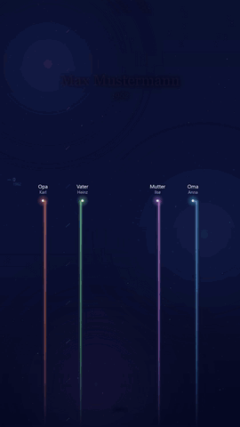

# Lebenslinien

**Deutsch** · [English](README.en.md)

[](https://github.com/EdgarM73/LebensLinien/actions/workflows/test.yml)
[](https://github.com/EdgarM73/LebensLinien/releases)
[](https://github.com/EdgarM73/LebensLinien/pkgs/container/lebenslinien)
[](LICENSE)

Erzeugt aus einer Person in **Gramps Web** oder einer **GEDCOM-Datei** (z. B. aus webtrees) ein Hochformat-Video (1080×1920): Jede Person aus der
engeren Familie ist ein leuchtender Faden. Neue Menschen schwingen in dein Leben (Geburt, Hochzeit),
Verstorbene steigen als Sterne auf, am Ende verbindet sich alles zu einem Sternbild.

<p align="center"></p>
<p align="center"><sub>Beispiel mit erfundenen Daten (beschleunigt) · <a href="Lebenslinien.mp4">Video ansehen</a></sub></p>

Idee: [@SecretFire79](https://x.com/SecretFire79)

## Funktionen

- **Familie aus Gramps Web oder GEDCOM:** Großeltern, Eltern, Geschwister, Partner, Kinder, Enkel und deren Ehepartner – live über die REST-API von Gramps Web (Leserechte genügen) oder aus einer GEDCOM-Datei, wie sie webtrees, Gramps, MyHeritage, Ancestry und andere exportieren.
- **Freunde, Kollegen und andere Wegbegleiter** lassen sich von Hand ergänzen.
- **Lebendige Darstellung:** Neugeborene entstehen an ihrem Platz, Paare und Familien stehen beieinander, eine Scheidung lässt die Linie wegdriften, Verstorbene werden zu Sternen.
- **Weboberfläche** mit Konten, Verbindungstest, Personensuche, Vorschaubild, Fortschrittsanzeige und Hintergrundmusik – oder die **Kommandozeile**.
- **Sprachen:** Video auf Deutsch, Englisch, Türkisch und Bosnisch, Oberfläche auf Deutsch und Englisch.
- **Ohne Namen:** auf Wunsch nur Beziehungen („Ich“, „Ehefrau“, „Sohn“ …), etwa um das Video zu zeigen, ohne Namen lebender Personen preiszugeben.
- **Selbst gehostet:** Die Daten verlassen den eigenen Server nicht.

## Schnellstart mit Docker

Es gibt ein fertiges Image für amd64 und arm64: `ghcr.io/edgarm73/lebenslinien`. Am einfachsten mit dem Repository:

```bash
git clone https://github.com/EdgarM73/LebensLinien.git lebenslinien
cd lebenslinien
cp .env.example .env          # danach in .env den Einladungscode APP_REGISTRATION_KEY ersetzen
docker compose pull
docker compose up -d
```

Ohne Repository reicht auch eine eigene `compose.yaml`:

```yaml
services:
  lebenslinien:
    image: ghcr.io/edgarm73/lebenslinien:latest
    restart: unless-stopped
    environment:
      APP_REGISTRATION_KEY: hier-einen-langen-zufaelligen-code-eintragen
    ports:
      - "127.0.0.1:3000:3000"
    volumes:
      - lebenslinien_data:/data

volumes:
  lebenslinien_data:
```

Danach `http://127.0.0.1:3000` öffnen, mit dem Einladungscode ein Konto anlegen und die Gramps-Verbindung eintragen oder eine GEDCOM-Datei hochladen.
Statt `latest` lässt sich eine feste Version angeben, z. B. `:2026.11.01`. Selbst bauen geht mit `docker compose up --build -d`.

Alles Weitere – Einstellungen, Betrieb hinter einem Reverse Proxy, lokaler Start ohne Docker und Fehlerhilfe – steht in der
**[Anleitung](ANLEITUNG.md)**.

## Weboberfläche

Pro Konto werden die Quelle (Gramps-Verbindung oder GEDCOM-Datei), die Hauptperson, Zusatzpersonen, Schlusstext und Hintergrundmusik gespeichert.

- **Verbindung testen** prüft Adresse und Zugangsdaten sofort; die **Personensuche** findet die Hauptperson per Name.
- **Vorschaubild** von Mitte oder Schluss in wenigen Sekunden, bevor das ganze Video entsteht.
- Das Video entsteht **im Hintergrund** mit Fortschrittsbalken und lässt sich danach direkt abspielen und herunterladen.
- Optionen: Videosprache, mit oder ohne Namen, Bezeichnung der Hauptperson, Enkel ein- oder ausblenden, Dauer, eigene Musik (MP3, WAV, M4A, AAC, OGG, FLAC bis 50 MB) oder ohne Musik. Ohne eigene Datei läuft die Standardmusik.
- Konto-Dialog zum Ändern des Passworts und zum Löschen des Kontos; Oberfläche auf Deutsch oder Englisch (Umschalter DE/EN).

Lokal ohne Docker (Node.js ≥ 18 und `ffmpeg` im PATH):

```bash
npm install
npm run web
```

**Sicherheit:** Gramps-Passwörter werden mit AES-256-GCM verschlüsselt, Kontopasswörter als scrypt-Hash gespeichert, Gramps-Verbindungen
brauchen HTTPS (HTTP nur für `localhost`). Registrieren kann sich nur, wer den Einladungscode kennt. Für den Zugriff von außen gehören ein
HTTPS-Reverse-Proxy, `COOKIE_SECURE=true` und `APP_TRUSTED_PROXIES=1` dazu; mit `APP_ALLOWED_GRAMPS_HOSTS` lassen sich die erlaubten
Gramps-Server festlegen. Die Daten (Konten, Videos, Musik, `master.key`) liegen im Volume bzw. im Ordner `data/` – für Backups
`master.key` immer zusammen mit `users.json` sichern. Details in der [Anleitung](ANLEITUNG.md).

## Kommandozeile

Voraussetzungen: Node.js ≥ 18, `ffmpeg` im PATH und einmalig `npm install`.

Pro Hauptperson gibt es eine eigene Konfigurationsdatei `config_<name>.json` (z. B. `config_opa.json`), kopiert aus
`config.example.json`. Darin stehen der Zugang (`url`, `username`; das Passwort besser über die Umgebungsvariable
`GRAMPS_PASSWORD`), die Hauptperson (`person`: Gramps-ID oder Name) und deren `extras` (Freunde, Kollegen).

```bash
node src/index.js config_opa.json
```

**Ohne Gramps Web, mit einer GEDCOM-Datei** (z. B. Export aus webtrees unter „Verwaltung → Stammbäume → Exportieren“):
statt `url` und `username` den Pfad zur Datei angeben, relativ zur Konfigurationsdatei. `person` ist dann die ID aus der Datei
(z. B. `I24`) oder ein Name.

```json
{ "gedcom": "familie.ged", "person": "I24", "lang": "de" }
```

Das Video heißt wie die Person, z. B. `Max Mustermann.mp4` (änderbar mit `--out` oder `"out"` in der Konfiguration).
Bei mehreren Namenstreffern werden die Gramps-IDs aufgelistet; dann `person` auf die ID setzen.

| Option | Bedeutung |
|---|---|
| `--demo` | Beispieldaten, ohne Konfiguration |
| `--still 30` | nur ein Standbild (PNG) bei Sekunde 30; auch `--still middle` oder `--still end` |
| `--dump modell.json` / `--model modell.json` | berechnete Daten speichern bzw. daraus rendern (prüfen oder von Hand korrigieren) |
| `--lang de\|en\|tr\|bs` | Sprache des Videos (`"lang"`) |
| `--seconds 60` | Dauer des Lebenslaufs ohne Schluss (`"seconds"`) |
| `--no-grandchildren` | ohne Enkel (`"grandchildren": false`) |
| `--anonymous` | ohne Namen, nur Beziehungen (`"anonymous": true`) |
| `--main-label Opa` | Bezeichnung der Hauptperson ohne Namen (`"mainLabel"`, auch je Sprache: `{"de": "Opa", "tr": "Dede"}`) |
| `--audio musik.mp3` | eigene Hintergrundmusik (`"audio"`); ohne Angabe läuft die Standardmusik |
| `--no-audio` | ohne Musik (`"audio": false`) |
| `--size 720x1280`, `--fps 30` | Bildgröße und Bildrate |
| `--extras datei.json` | zusätzliche Wegbegleiter aus einer eigenen Datei |

## Sprachen

Verwandtschaftsbezeichnungen, „Ich“, die Altersanzeige und der Schlusstext gibt es auf Deutsch (`de`, Standard), Englisch (`en`),
Türkisch (`tr`) und Bosnisch (`bs`). Im Türkischen heißt die Oma je nach Seite „Babaanne“ oder „Anneanne“. Alle Texte stehen in
`src/i18n.js`, dort lässt sich auch eine weitere Sprache ergänzen. Der Schlusstext lässt sich pro Person mit `"texts"` überschreiben.

## Freunde, Kollegen und andere Nicht-Verwandte

In der `config_<name>.json` unter `"extras"` (oder in der Weboberfläche unter „Weitere Menschen“):

- `name`, `rel` (Beschriftung, z. B. „Freund“) und `start` (Jahr oder „1988-03“) sind Pflicht.
- `end` (optional): ohne Angabe bleibt die Person bis zum Schluss. Mit `end` driftet die Linie weg (Kontakt eingeschlafen);
  mit `"exit": "star"` steigt sie als Stern auf (verstorben).
- Statt `name` geht auch `"id": "I0123"`: Name und gegebenenfalls Sterbedatum kommen dann aus Gramps.
- `"rel"` kann ein fester Text sein, `"friend"` / `"colleague"` (wird übersetzt) oder je Sprache: `{"de": "Nachbar", "tr": "Komşu", "bs": "Komšija"}`.

## Was dargestellt wird

Großeltern, Eltern, Geschwister (auch Halbgeschwister), Partner, Kinder und Enkel samt deren Ehepartnern. Die Zeitleiste beginnt
zwei Jahre vor der Geburt der Hauptperson; sie selbst steht immer in der Bildmitte.

- **Seiten:** Vater links, Mutter rechts, Großeltern auf der Seite ihres Kindes; Geschwister, Partner, Kinder und Enkel wechseln sich ab, Freunde stehen außen.
- **Nähe:** Je näher an der Mitte, desto enger die Beziehung (Kinder, Partner, Eltern/Enkel, Geschwister, Rest).
- **Familien:** Schwiegerkinder stehen direkt neben ihrem Partner, Enkel schließen sich an. Um Paare und Familienblöcke bleibt etwas mehr Platz.
- **Ereignisse:** Für Neugeborene wird der Platz schon 10 Monate vorher freigemacht; eine Scheidung lässt die Linie wegdriften; am Ende werden nur Verstorbene zu Sternen, die Lebenden bleiben unten.

Personen ohne Datum werden übersprungen und beim Start als Hinweis ausgegeben.

## Entwicklung und Tests

```bash
npm test
```

Die Tests prüfen das Modell anhand von `test-stammbaum-huber.ged` sowie Weboberfläche, Sitzungen, Anmeldebegrenzung, Konto,
Suche und Vorschaubild. Eine GitHub Action führt sie bei jedem Push aus und rendert ein Standbild mit Beispieldaten; eine zweite
baut bei jedem Release-Tag das Docker-Image.

Optionale Live-Tests laufen gegen eine Gramps-Web-Instanz, in die derselbe Stammbaum importiert ist. Die Zugangsdaten gehören in die
lokal ignorierte `config_test.json` (`url`, `username`, `password`) oder in `GRAMPS_TEST_URL`, `GRAMPS_TEST_USERNAME` und
`GRAMPS_TEST_PASSWORD`. Die Live-Tests lesen nur.

Änderungen je Version: [RELEASE_NOTES.md](RELEASE_NOTES.md)

## Lizenz

[MIT](LICENSE)

Die Standardmusik „Journey of Life“ (`assets/music/journey-of-life.mp3`) wurde mit Suno erstellt.
